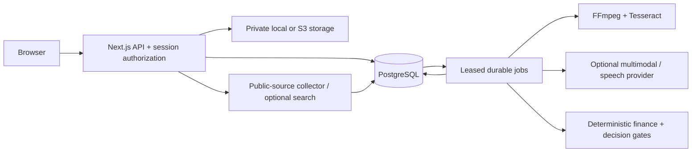

# Architecture

## Runtime

AgencyOS is a modular monolith with two process roles: a Next.js 16 web/API process and a TypeScript background worker. PostgreSQL 17 stores application records and durable jobs. Using a PostgreSQL queue avoids requiring Redis for this workload; the queue can be replaced by BullMQ behind the worker boundary if future throughput warrants it.

React 19 and custom CSS provide the dashboard. Drizzle provides typed workspace-scoped queries for core records; parameterized PostgreSQL queries handle transactions, the durable queue and composite relationships. `migrations/*.sql` is the canonical complete schema. The Drizzle schema is a query projection, not an alternative migration source.

## Data ownership

`workspaces` and `memberships` define tenant membership. Sessions bind both a user and an active workspace; membership is checked on every session lookup, so membership removal invalidates access even before cookie expiry. API clients never supply the authoritative workspace ID.

Business records include clients, products, offers, financial profiles, competitors, creatives, creative versions, analyses, forecasts, recommendations, research sources, opportunities, trends, experiments, knowledge findings and audit logs. Composite `(workspace_id, client_id)` and `(workspace_id, creative_id)` foreign keys prevent cross-tenant parent references. Services and HTTP handlers always scope queries to the session workspace. Database RLS is not enabled; see the defense model and extension rules in SECURITY.md.

Financial profiles store validated JSON inputs. Analyses snapshot the economics used, assumptions, source timestamps, model version, provider, warnings and provenance. Changing a client profile does not silently rewrite old analysis outputs. The interactive profitability page uses the current profile and saves separate forecast records.

## Upload to decision

1. Authenticate and validate Origin. Rate-limit workspace writes and uploads.
2. Cap the multipart body at 100 MB plus field overhead; validate extension, MIME and container signature.
3. Persist a private object under generated workspace/client/creative IDs; persist creative and job atomically. Roll back the object on transaction failure.
4. Claim work with `FOR UPDATE SKIP LOCKED`, issue a lease token, and heartbeat the lease. A worker handles one video at a time.
5. Probe the container; reject unsupported codecs/containers, excessive dimensions, duration or frame rate. Extract scenes and a bounded set of temporal frames with priority for the first three seconds. OCR is local. Audio is mono 16 kHz WAV.
6. Use the simulated fixture only for an explicitly simulated client. Otherwise, optionally transcribe and analyze with a configured model; validate output structure, score coverage and timeline bounds. Failed or absent providers fall back to explicitly limited local evidence.
7. Load tenant/client-scoped research evidence. Generate source-linked gap hypotheses and trend candidates. Unknown metrics remain null.
8. Compute unit economics, scenarios, sensitivity, a conservative recommendation and experiment proposal in deterministic code.
9. In a single transaction, check the current lease token, upsert the analysis, replace its derived records, preserve version/experiment lineage and complete the job. No partial analysis becomes visible as complete.

## Retry and cache behavior

- Unique `(workspace_id, creative_id, kind)` jobs prevent duplicate queue records.
- A processing lease expires after 15 minutes and is renewed every 30 seconds. Three attempts are allowed, with a 15-second delay between attempts. A dead worker on its final attempt is moved to a failed state after expiry.
- Analysis records are unique per tenant/creative. Reprocessing preserves the original and any variants already linked to experiments.
- Multimodal results are cached for seven days using tenant, file hash, context, model and analysis version. Every read checks the tenant as well as the key. The metadata/OCR pipeline can be rerun without invoking the model again.
- Public-source evidence is cached for 24 hours, by tenant, client and URL. Sources carry fetch timestamps; refreshing the creative explicitly uses the latest evidence.
- Failed provider responses are not cached as successful multimodal analyses. UI status distinguishes queued, processing, complete and failed.

## Creative knowledge graph

The V1 graph is relational: original creative → versions → experiments → user-entered results. Fingerprints include industry, platform, format, length, hook, emotion, human/founder/customer presence, product appearance, demonstration, testimonial, price, proof, CTA and offer. Unknown attributes are null/unknown.

`knowledge_findings` reserves client/industry scope, period boundaries, sample size, confidence and the finding payload. No cross-client learning claims or universal correlations are generated. Future analytics must account for attribution, selection effects, geography, period, refund delays and repeated testing before promoting associations.

## Extension boundaries

`providers.ts` defines read-only adapters for advertising, commerce, analytics and CRM. There is intentionally no campaign execution method. Later approval-based execution needs a separate capability model, spend limits, idempotency keys and audit events; it must not be added as a side effect of analysis.

The web process streams private media responses from storage with tenant authorization and byte-range support, although V1 reads each object into memory before responding. The 100 MB cap and deployment concurrency limits bound this. For larger files, use authorized short-lived S3 URLs or streaming reads and retain the same authorization boundary.
